## 👨‍💻 About me

- 🏢 Software Engineer at **BluBird Interactive Ltd.**, Dhaka 🇧🇩
- 🤖 Building **Claude Code plugins and AI developer workflows**: [ai-workflow](https://github.com/masnun-siam/ai-workflow), [cc-profiles](https://github.com/masnun-siam/cc-profiles)
- 🌱 Currently learning **Docker & AWS**
- ⚡ Fun fact: hardcore **Vim** user who loves watching **anime**

## 🛠️ Tech stack

**Mobile** 

**Backend & Web** 

**Tools & DevOps** 

## 🚀 Featured projects

<a href="https://github.com/masnun-siam/ai-workflow"><picture><source media="(prefers-color-scheme: dark)" srcset="./profile/pin-ai-workflow-dark.svg"></picture></a>
<a href="https://github.com/masnun-siam/cc-profiles"><picture><source media="(prefers-color-scheme: dark)" srcset="./profile/pin-cc-profiles-dark.svg"></picture></a>
<a href="https://github.com/masnun-siam/typevocal"><picture><source media="(prefers-color-scheme: dark)" srcset="./profile/pin-typevocal-dark.svg"></picture></a>
<a href="https://github.com/masnun-siam/dpdc_balance_checker"><picture><source media="(prefers-color-scheme: dark)" srcset="./profile/pin-dpdc_balance_checker-dark.svg"></picture></a>
<a href="https://github.com/masnun-siam/samftp-flutter"><picture><source media="(prefers-color-scheme: dark)" srcset="./profile/pin-samftp-flutter-dark.svg"></picture></a>
<a href="https://github.com/masnun-siam/bd-govt-job-autofill"><picture><source media="(prefers-color-scheme: dark)" srcset="./profile/pin-bd-govt-job-autofill-dark.svg"></picture></a>

## 📊 GitHub stats

<picture><source media="(prefers-color-scheme: dark)" srcset="./profile/stats-dark.svg"></picture>
<picture><source media="(prefers-color-scheme: dark)" srcset="./profile/langs-dark.svg"></picture>
  
<picture><source media="(prefers-color-scheme: dark)" srcset="https://raw.githubusercontent.com/masnun-siam/masnun-siam/output/snake-dark.svg"></picture>

