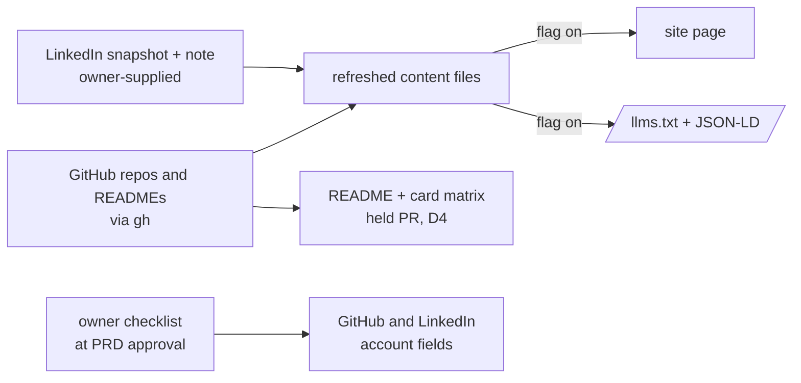

# PRD — Refresh portfolio data from LinkedIn and GitHub

**Status:** Approved · **Date:** 2026-10-22 · **Slug:** `content-refresh` · **Owner:** Masnun Siam · **Priority:** medium · **Repo:** masnun-siam/masnun-siam

## Overview

The portfolio at `masnunsiam.com` and the GitHub profile README show Masnun's work history, projects, skills and links. Masnun reports that this data is out of date. This feature brings it in line with his current LinkedIn profile and his current GitHub account, once, and makes the GitHub profile point at the live site.

Today:
- The site renders four content files: profile (name, tagline, location, About, email, socials), work (four roles), projects (six cards) and skills (three groups). They were filled by hand on 2026-10-18 from the old Flutter portfolio and the README. LinkedIn was not read directly, because it returns HTTP 999 to anything that is not logged in.
- The same content feeds `/llms.txt` and the JSON-LD (Person, `worksFor`, `sameAs`) from the SEO/AEO epic (#41), which is merged dark behind `FEATURE_SEO_AEO`.
- The README (GitHub profile page) has its own About bullets, tech-stack badges and six pinned-project cards. Its cards differ from the site: it shows `samftp-flutter` where the site shows `clippy`. The daily card workflow regenerates the cards for the repos in its matrix and never deletes old ones.
- The GitHub account is stale too. Its website field is `msiamn.dev` and its public email is `echo@msiamn.dev`, a domain with no DNS records. Its pins include `msiamn-dev`, the dead Flutter portfolio this site replaced, and that repo's homepage field is `https://msiamn.dev`.
- The closest existing pattern is the `FEATURE_SEO_AEO` build-time flag and its CI states (SEO/AEO FR-7 and D5, issues #48 and #49, both still open).

## Problem

A recruiter who reads the site, the README or the GitHub profile header can see an out-of-date picture. Roles, About text and skills may not match LinkedIn. The site and the README disagree on featured projects. The GitHub profile's website and email point at a dead domain. Answer engines that read `llms.txt` and the JSON-LD repeat the same stale facts.

## Users

- **Visitors** (recruiters, hiring managers, developers, answer engines): read-only.
- **Owner** (Masnun): supplies the LinkedIn snapshot and makes the account-level edits that no API allows.

## Goals

- Every fact on the site, in `llms.txt`, in the JSON-LD and in the README matches LinkedIn and GitHub as of the snapshot date.
- The site, the README and the GitHub pins feature the same projects in the same order.
- The GitHub profile header links to `masnunsiam.com` and a working email.

## Non-goals

- No automatic or scheduled sync with LinkedIn or GitHub (D6).
- No write-back to LinkedIn. LinkedIn is the source of truth for the work history, headline and About; only its contact-info website field is changed (FR-7).
- No new sections: still no Education, Awards, Certifications or resume download (the portfolio PRD's non-goals stand).
- No layout or styling changes. The only schema change is the FR-2 highlight length cap.
- No change to the stats, languages or snake cards.

## Requirements

- **FR-1 LinkedIn snapshot.** The refresh uses one dated snapshot of Masnun's LinkedIn profile that he supplies (D1). Handling:
  - The snapshot stays a Paperclip task attachment. An agent reads it only in a temporary directory outside the repo, extracts the fields FR-2, FR-3 and FR-5 need, and deletes the directory before its run ends.
  - The snapshot file and its non-public fields (phone, email, address, birth date, connections, "open to work") never appear in the repo, a PR, a comment or a log. Public profile text that goes on the site (headline, About, positions, skills) may be quoted in the PR's comparison table, since the refreshed content files are public in the repo anyway.
  - As a backstop to the temp-dir rule (not the main control), a root `.gitignore` gains `*.pdf` and `*.zip`, and a CI check that runs on every PR, whatever paths it touches, fails any PR that adds a file whose name ends in `.pdf` or `.zip`, matched case-insensitively.
  - Field sources: positions, headline, About and location come from the snapshot. The full skills list, each role's skills, and the workplace type (Remote, On-site or Hybrid) of every position not on the site today come from Masnun's note with the snapshot. A field that neither has keeps its current value. A required field with no source and no current value (a new position's workplace type) is never invented: its task blocks and asks Masnun.
  - Acceptance: the epic records the snapshot date; the CI check fails a test PR that adds `docs/test.PDF` (outside `site/`).
- **FR-2 Work timeline.** Every position in the snapshot appears as a role, with company, title, start and end month, and location as on LinkedIn, and mode per FR-1. Each highlight is a plain-text line of at most 120 characters, at most 4 per role, taken from LinkedIn's description; the 120-character cap is added to the `work` schema. Tags are the role's skills from Masnun's note, else the current tags. A position in the snapshot but not on the site is added; a role on the site but not in the snapshot is removed.
  - Acceptance: the PR's comparison table (snapshot vs refreshed `work` content) has no mismatched cell; the role count on the page equals the snapshot's position count.
- **FR-3 Profile.** `tagline` is LinkedIn's headline in the existing "Title · skill · skill" form, at most 60 characters. `about` is LinkedIn's About in first person, trimmed to at most 3 paragraphs of at most 400 characters each. Both caps are added to the `profile` schema. `location` matches LinkedIn. `email` stays `echo@masnunsiam.com`. `socials` keep their four fixed links; only those four URLs are fetched, and nothing from the responses is written anywhere.
  - Acceptance: the PR's comparison table shows the LinkedIn headline and About next to the new values; each of the four social URLs returns 200 (LinkedIn: 200 or 999, its response to anyone not logged in).
- **FR-4 Featured projects.** The site shows the six projects in D2, in that order. Each `description` is the agent's own plain-language summary of the repo's current README, at most 140 characters. Each card's `tags` are the repo's primary language plus up to four technologies the README names. An existing `demo` link is kept if it still returns 200; otherwise it is dropped.
  - Acceptance: six cards in the D2 order; each card's repo link returns 200, and the repo is public and not archived.
- **FR-5 Skills.** The three groups stay. Each skill in Masnun's skills list (FR-1) that fits a group is added to it. Existing items stay unless the list contradicts them. No item appears in more than one group.
  - Acceptance: every skill in the list is either on the page or listed in the PR with the reason it was left out.
- **FR-6 README cards and card workflow (GitHub slice).** The README's pinned cards show exactly the D2 projects, in order. The card workflow's matrix lists exactly those repos. The change to `profile.yml` is limited to the matrix `item` list: no change to permissions, secrets, triggers or action versions. The split between what merges early and what waits for release is D4.
  - Acceptance: the README's six card links equal the site's six repo links, in order. A file listing of `profile/` on `main` after release shows `pin-*` files for exactly the D2 repos, and every README image URL returns 200.
- **FR-6b README About and tech stack (LinkedIn slice).** The README's About bullets match FR-3 (role, employer, what Masnun builds), and its tech-stack badges match the FR-5 skill groups. This ships with FR-3 and FR-5, in the same held README PR (D4); if those move to a follow-up, so does this, and the README keeps today's About and badges.
  - Acceptance: each README About bullet and badge has a matching FR-3 or FR-5 value in the on-state content.
- **FR-7 Account-level profile fixes (owner).** When the PRD is approved, Masnun gets an ordered checklist (D5). Each item has a direct settings URL and the exact value to enter:
  1. Mail for `masnunsiam.com`: `masnunsiam.com` has no MX record today, so `echo@masnunsiam.com` (the site's contact link) bounces, although #20 was closed. In Cloudflare → Email → Email Routing: enable it, accept its MX and SPF records, and route `echo` to Masnun's inbox (the #20 step 4).
  2. GitHub website → `https://masnunsiam.com`.
  3. GitHub public email → `echo@masnunsiam.com`, after item 1: verified on GitHub and set public. This accepts that the address is visible on GitHub, where it already is on the site. Commits keep using a `noreply` address.
  4. GitHub pins → the D2 six, in order.
  5. Other `msiamn.dev` references: the `msiamn-dev` repo's homepage field (the only one a `gh` sweep of public repos found) → clear it; the Stack Overflow profile website (empty today) → `https://masnunsiam.com`; the Google Developer profile `g.dev/msiamn` → check for `msiamn.dev` and replace it. Then either keep `msiamn.dev` renewed, or let it lapse only after every reference is gone: a lapsed domain can be re-registered and used to receive mail. This last part stays advisory.
  6. LinkedIn contact-info website → `https://masnunsiam.com`.
  - The checklist ends with the verification commands.
  - Acceptance: `dig MX masnunsiam.com` returns a record, and a test mail to `echo@masnunsiam.com` arrives. `gh api users/masnun-siam` shows `blog` = `https://masnunsiam.com` and `email` = `echo@masnunsiam.com`. The GraphQL `pinnedItems` list equals D2. `gh repo list masnun-siam --json homepageUrl` has no `msiamn.dev`. The Stack Exchange API shows the website. Masnun confirms the LinkedIn and g.dev edits in a task comment. The Release stage checks these and reminds Masnun of any item still open.
- **FR-8 Behind the flag.** With `FEATURE_CONTENT_REFRESH` off, the site build is the same as today. With it on, the site uses the refreshed content (D3), and `/llms.txt` and the JSON-LD follow whichever content the build used. The flag reaches the build only as a fixed workflow expression, as in SEO/AEO FR-7.
  - Acceptance: CI builds, checks (`astro check`) and tests both D7 states on every PR. In the PR that adds the switch, a one-time comparison builds the base commit in a second checkout and runs `diff -r` on the two off-state `dist/` folders. If hashed asset names differ, only the HTML and text outputs are compared. The result is recorded in the PR.
- **FR-9 Source text is data.** Snapshot and README text is untrusted input that becomes site copy, `llms.txt` and JSON-LD. Highlights, About, tagline and descriptions are plain text. No markdown, HTML or URLs are copied through, and no sentence addressed to a reader or a model is kept. Every URL in the content comes from the fixed socials or from `https://github.com/masnun-siam/<repo>`, and passes the existing schema. The PR reviewer reads the on-state `llms.txt` diff for anything addressed to a model.
  - Acceptance: in the on-state content files, the text fields (tagline, about, highlights, descriptions, tags) contain no `<`, `](` or `http`. In the on-state `llms.txt`, every URL is one of the allowed URLs or on `https://masnunsiam.com`, and the only link syntax is the builder's own `[label](url)` lines.

## Edge cases

- **No snapshot yet:** the GitHub slice (FR-4, FR-6, FR-7) does not wait for it. The tasks for FR-2, FR-3, FR-5 and FR-6b are blocked until the snapshot is on PER-101. If the snapshot has not arrived when everything else is done, the release can ship the GitHub slice, and FR-2, FR-3, FR-5 and FR-6b move to a follow-up.
- **A position with no description:** the role gets one highlight, derived only from its title and the skills Masnun lists for it, never invented. It is marked as derived in the PR table.
- **A position with more than 4 bullets:** keep the four most specific (named tech, outcome, scope).
- **An ongoing role:** no `end`, so it renders "Present", as today.
- **Pre-2020 positions:** included like any other. The timeline shows whatever the snapshot lists.
- **A featured repo goes private, is archived or is renamed before release:** FR-4's check fails the PR; it is replaced by the D2 fallback.
- **The snapshot is older than 30 days at release:** the release confirmation asks Masnun whether LinkedIn changed since then. If it did, a new snapshot and a follow-up PR.
- **Existing data:** no migration. The current content is the off state until release.
- **The SEO/AEO epic (#41):** it reads the same content and is still landing. Its specs that assert content values must pass in both D7 states.

## Technical design

*Where each piece of data comes from and where it ends up. The README and the account fields are not behind the site flag (D4, D5).*

### Data

The four content collections keep their schemas, except for three length caps: each `work` highlight at most 120 characters (today's longest is 100), the `profile` tagline at most 60 and each About paragraph at most 400 (today's longest is 305). The project `description` cap of 140 is already in the schema. Today's content passes all of them, so the off state is unchanged. A second copy of the four content files holds the refreshed data (D3). The content config chooses which copy to load from `FEATURE_CONTENT_REFRESH` at build time; nothing else in the site knows about the flag. Serves FR-2 to FR-5 and FR-8.

### API

Not affected.

### Backend

The card workflow's matrix changes (FR-6, D4). No other workflow logic changes, except the CI additions under Testing and Rollout.

### Frontend

Only the rendered content changes. Empty and long-content states are unchanged. With the flag on, the page must still meet the portfolio PRD's FR-8: 320 px to desktop, both themes, no horizontal scroll.

### Realtime and other services

Not affected.

### Non-functional

- No new dependency.
- Snapshot handling and source text: FR-1 and FR-9.
- Page weight changes only by the text added.

### Testing

- Every Playwright spec that asserts content values (today `content.spec.ts`, `llms.spec.ts`, `meta.spec.ts`, plus any JSON-LD spec from #41) reads `FEATURE_CONTENT_REFRESH` and asserts the matching state. The off state keeps today's assertions. The on state takes its counts (roles, cards, groups) from the refreshed content files, and hand-types the key strings (tagline, first role title, the D2 repo links), so it checks both rendering and data. This builds on the state-aware runner from #49. Serves FR-2 to FR-5 and FR-8.
- `astro check` runs in each D7 state (FR-2 to FR-5).
- A CI check on every PR, without a path filter, fails a PR that adds a `.pdf` or `.zip` in any case (FR-1).
- The one-time off-state `dist/` comparison (FR-8).
- Manual, recorded in the PR: the comparison table (FR-2, FR-3, FR-5); the link checks (FR-3, FR-4); with the flag on, screenshots of the preview at 320 px and desktop in light and dark, showing no horizontal scroll or clipped text; Lighthouse Accessibility ≥ 95 on the on-state preview (portfolio PRD FR-8); and the reviewer's read of the `llms.txt` diff (FR-9).
- FR-6 and FR-7 are checked by the file listing and `gh` commands in their acceptance lines.

## Rollout and cost

- Flag: `FEATURE_CONTENT_REFRESH`, a GitHub Actions repository variable, default **off**, added to `FLAGS.md`. Merging deploys the code dark.
- Dependency: E1 is blocked by #48 (two-state PR build, `workflow_dispatch`, flag passed to the build) and #49 (state-aware specs). The epic extends them; it does not rebuild them.
- Release, after Masnun confirms:
  1. Set `FEATURE_CONTENT_REFRESH=true`.
  2. Dispatch the deploy workflow on `main`. Setting a variable alone starts no build.
  3. Rebase the held README PR (D4) on `main` and merge it.
  4. Check that the live site shows the refreshed role count and tagline, and that every README image returns 200.
  5. Record `released <tag>` in `FLAGS.md`, and remove the flag from the workflow's list of unreleased flags (D7).
  6. Check FR-7 and remind Masnun of any item still open.
- After release: the last issue of E1 promotes the refreshed copy to be the only copy and removes the switch (D3).
- Cost: none.

## Success metrics

- A visitor who reads the site, the README, the GitHub profile header or an answer engine's summary sees one consistent, current picture of Masnun. Checked once after release: no mismatch between the snapshot, the live site, `llms.txt`, the README and the FR-7 `gh` checks.

## Epics

- **E1 Refresh portfolio data from LinkedIn and GitHub** — covers FR-1 to FR-9, including FR-6b. Issue: —

## Decisions

- **D1 LinkedIn source** — status: settled (round 2, all lenses agree).
  - Round 1: CTO and Critical disagreed. A profile PDF carries only the top 3 skills, with no per-role skills, no workplace type and no Projects section, so FR-2 and FR-5 had no source for some fields. Critical preferred the data export; Security, CEO, QA and UX agreed with the PDF.
  - Options:
    - (a) **The LinkedIn profile PDF ("More → Save to PDF") plus a short note from Masnun with his full skills list, each role's skills, and the workplace type of every position not on the site today (recommended).** Round 2 (Critical): the scope was "added or changed since 2024", which left an older new position with no `mode`; widened, and a missing required value blocks and asks instead of being invented (FR-1).
    - (b) The LinkedIn data export ZIP (Profile, Positions, Skills, Projects).
    - (c) Masnun pastes everything as text.
    - (d) An agent drives a logged-in browser session.
  - Why (a): the PDF is instant and carries the least private data. The note fills exactly the fields it lacks, and FR-1 keeps the current value when neither source has a field, so nothing has to be invented. (b) has the full skills list and projects, but no workplace type or per-role skills either. It can take up to a day, and its Profile file carries a birth date and an address. (c) works but is the most effort for Masnun. (d) uses Masnun's session without him present and breaks LinkedIn's terms.
  - Masnun's question on this task has been reissued to ask for (a), and (b) and (c) are also accepted. Each source maps to fields by the same FR-1 rules.
- **D2 Featured projects** — status: settled (round 2, all lenses agree).
  - Round 1: CEO disagreed. The claim that `pi-session-review` is more substantial than `bd-govt-job-autofill` was unsupported. Checked: they have similar code sizes, 9 and 12 commits, and `bd-govt-job-autofill` has the longer README and a description. Masnun pinned both on GitHub. The "LinkedIn Featured takes priority" clause contradicted FR-4 (Critical).
  - Options:
    - (a) **Keep the current six (ai-workflow, cc-profiles, typevocal, dpdc_balance_checker, clippy, bd-govt-job-autofill), refresh their descriptions, and align the README and the pins to them. Fallback: pi-session-review (recommended).**
    - (b) The round-1 set, with pi-session-review instead of bd-govt-job-autofill.
    - (c) Mirror the current GitHub pins.
  - Why (a): there is no evidence that a newer repo beats a current card. The set was approved four days ago, and only the README and the pins drifted from it. Left out: `nestcare` and `meeting-manager` are private. `snack-voting` is an internal office tool with no description. `pi-ai-workflow` is a port of ai-workflow, which is already featured. (c) would feature the dead `msiamn-dev` and drop ai-workflow and cc-profiles. The LinkedIn-priority clause is dropped.
- **D3 How the flag switches content** — status: settled (round 1, all lenses agree). A second copy of the four content files, loaded when the flag is on. The last issue of E1 promotes it and removes the switch after release (CEO). One switch in one place, and the off state is untouched by construction.
- **D4 README and card workflow timing** — status: settled (round 2, all lenses agree).
  - Round 1: QA disagreed. Without extra steps, the README would show broken images at merge, because the new pin SVGs do not exist yet, and a held PR drifts against the daily card commits. CTO and Critical raised the same points.
  - Options:
    - (a) **Split the change. Merge the whole matrix change now: new cards that nothing references are not user-visible, and a removed repo's card stops refreshing but stays in place while the README still shows it. The held PR carries only the README and the `git rm` of the stale pin SVGs, so the daily card commits cannot conflict with it. The Release stage rebases it on `main` and merges it at release (recommended).** Round 2 (CTO): the matrix removal moved into the early merge.
    - (b) One held PR for everything, and the release dispatches `profile.yml` and waits for the new cards before the README is checked.
    - (c) Merge the README change immediately.
  - Why (a): the new cards exist on `main` before the README points at them, so no image is ever broken. The held PR only deletes files that the README stops referencing in the same commit. A rebase at release handles the daily card commits. Under D2 (a), the diff is small: `clippy` replaces `samftp-flutter`. (b) leaves a window of broken images on the live profile. (c) publishes before release.
- **D5 Account-level fixes** — status: settled (round 2, all lenses agree). Round 2 (Critical): the checklist starts with mail routing for `masnunsiam.com`, which has no MX record.
  - Round 1: all lenses agreed with an owner checklist. CEO's finding moves it from release to PRD approval: the GitHub website, email and pins depend on nothing in the epic. UX asked for an ordered list with direct URLs and exact values. Security added the `msiamn.dev` sweep.
  - Options:
    - (a) **An ordered owner checklist (FR-7), posted with the "PRD approved" notification. It blocks nothing, and the Release stage checks it and reminds Masnun (recommended).**
    - (b) Hand it over at release confirmation.
    - (c) Agents edit via API.
  - Why (a): the most visible stale fact (the dead website link in the GitHub header) gets fixed days earlier, and no task waits on it. (b) delays a fix that needs nothing from the epic. (c) is not possible: GitHub has no API for pins, the `gh` token has no `user` scope, and LinkedIn has no API for a personal profile.
- **D6 One-time refresh or ongoing sync** — status: settled (round 1, all lenses agree). A one-time refresh; the next refresh repeats this PRD's procedure. LinkedIn cannot be synced, and the portfolio PRD rules out live GitHub data.
- **D7 Flag states in CI** — status: settled (round 1, all lenses agree; Security's condition and CTO's list are applied). PRs build, check and test two states: every flag at its repository-variable value, and every flag on the workflow's explicit list of unreleased flags on. Only the second is uploaded for the preview. Production only ever deploys the single build that a push or dispatch on `main` makes with the repository-variable values, as in SEO/AEO FR-7. Each release removes its flag from the list.
- **D8 Priority** — status: settled (round 1, all lenses agree). Medium: nothing is broken, but the stale facts are the first thing a visitor reads.

## Open questions

None. The snapshot is an input to the FR-2, FR-3 and FR-5 tasks, not an open decision (see Edge cases).

## Change log

- 2026-10-22: approved after panel round 3 (round 1: PER-103 to PER-108; round 2: PER-109 to PER-114; round 3: PER-116, Critical only). The snapshot arrived on PER-101 the same day (Profile.pdf, comment 042ec4ea), with Masnun's note on the current role.

## Related

- [portfolio-site PRD](docs/prds/portfolio-site.md) (FR-2 to FR-6 content, FR-8 responsive, the Data section).
- [seo-aeo PRD](docs/prds/seo-aeo.md) (FR-7 flag and release trigger, D5); epic #41, issues #48 and #49.
- `FLAGS.md`, `.github/workflows/profile.yml`, `.github/workflows/deploy-site.yml`.
- Paperclip task PER-101; panel round 1: PER-103 to PER-108; round 2: PER-109 to PER-114.
