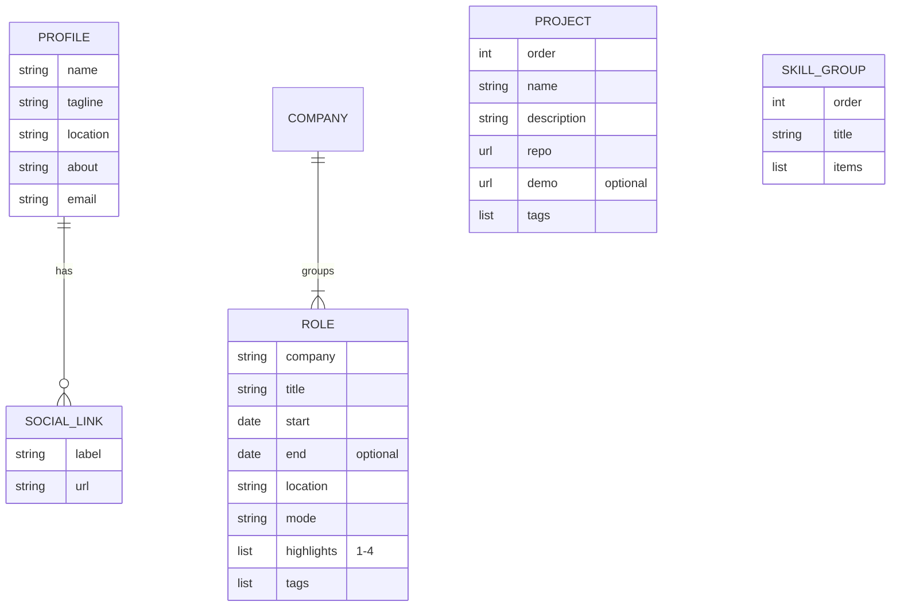
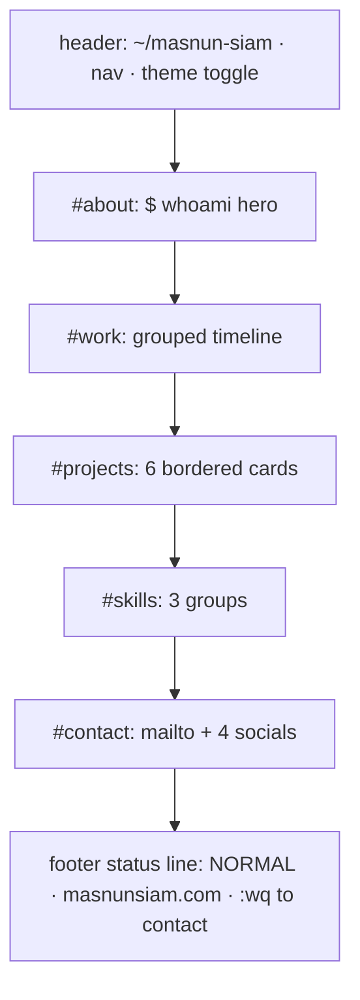
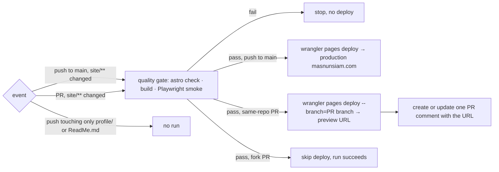

# PRD — Personal portfolio site

**Status:** Approved · **Date:** 2026-10-18 · **Slug:** `portfolio-site` · **Owner:** Masnun Siam · **Priority:** medium · **Repo:** masnun-siam/masnun-siam

## Overview

A personal portfolio website at `masnunsiam.com`, with a terminal/Vim-inspired look. It presents who Masnun is, his work history, selected projects, his tech stack and how to reach him. It is a static site built from this repository and deployed to Cloudflare Pages by GitHub Actions.

Today:
- This repository is Masnun's GitHub profile README: `ReadMe.md` at the root, generated stat and pin cards in `profile/`, and a daily workflow that regenerates those cards and commits them to `main`.
- The README's Website and Email badges point to `masnun-siam.com` / `echo@masnun-siam.com`. That domain is wrong: the owned domain is `masnunsiam.com` (no hyphen). It is already on Cloudflare nameservers, but nothing is served on it and it has no MX record.
- An earlier portfolio exists in a separate repo (`msiamn-dev`, Flutter web, deployed to Firebase at `msiamn.dev`). It is not live, and nothing from it is reused except its content, which is cross-checked against LinkedIn.
- No website code, `package.json` or deploy pipeline for a website exists in this repo.

## Problem

Masnun has no live personal site. Recruiters and collaborators who follow the README's website link get a dead domain, and the only place his full work history appears is LinkedIn, which requires a login to read.

## Users

- **Visitors** (recruiters, hiring managers, other developers): read-only and anonymous. No accounts, no roles.
- **Owner** (Masnun): edits content files in the repo and merges to `main` to publish.

## Goals

- A visitor can learn, in one page, what Masnun does, where he has worked, what he has built and how to contact him.
- The site loads fast and works on phone and desktop, in light and dark themes.
- Updating a job, project or skill is a one-file content edit followed by a merge to `main`.
- The GitHub profile links to a working site and a working email address.

## Non-goals

- No blog, no CMS and no Markdown posts.
- No contact form, no backend and no Pages Functions. Contact is by `mailto:` and social links only.
- No live GitHub API data: no star counts, no last-push dates, no auto-listed repositories.
- No resume/CV PDF download.
- No Awards or Education section. The NASA Space Apps awards and the B.Sc. are left out of this version.
- No multi-language (Bangla) support, unlike the old Flutter portfolio.
- No "open to work" or hire-me badge. LinkedIn's "Open to work" is set to recruiters only and stays private.
- No changes to the profile-card workflow or the `profile/` cards.
- No cookie banner, because the analytics are cookieless.

## Requirements

- **FR-1 Single-page layout.** One page with anchored sections in this order: Hero/About (`#about`), Work (`#work`), Projects (`#projects`), Skills (`#skills`), Contact (`#contact`). A header shows `~/masnun-siam` on the left and nav links to Work, Projects and Skills on the right. A Vim-style status line footer shows `NORMAL`, the domain, and a `:wq to contact` link to `#contact`.
  - Acceptance: the page has exactly those five sections with those ids, in that order. Each header nav link scrolls to its section. The footer's `:wq to contact` link goes to `#contact`.
- **FR-2 Hero/About.** A prompt-style hero: `$ whoami`, then the name "Masnun Siam" followed by a blinking block cursor, then the tagline "Software Engineer · Laravel · Flutter · AI tools", then a short paragraph adapted from the LinkedIn About text, then buttons for email, GitHub and LinkedIn. The location is Dhaka, Bangladesh. The cursor does not blink when the visitor has `prefers-reduced-motion: reduce` set.
  - Acceptance: the hero shows the name, tagline, location and three working links. With reduced motion emulated, the cursor is static.
- **FR-3 Work timeline.** A reverse-chronological list of roles from the content file. Each role shows the date range ("Mon YYYY – Present" or "Mon YYYY – Mon YYYY"), company, title, location and work mode, 1–4 bullet highlights, and tech tags. Roles at the same company are grouped under that company (Binary Fusion has two). Content at launch:
  - BluBird Interactive Ltd. — **Software Engineer**, Oct 2024 – Present, Dhaka · Remote. Shown as "Software Engineer" by the owner's decision, even though the LinkedIn entry says "Junior".
  - Binary Fusion — Senior Software Engineer (Mobile), Mar 2024 – Oct 2024, and Software Engineer (Mobile), Mar 2023 – Feb 2024, Dhaka · On-site.
  - Roxarth Manhattan — Junior Flutter Developer, Nov 2020 – Feb 2023, New York · Remote.
  - Bullet text and tags come from the LinkedIn experience entries, trimmed to at most 4 bullets per role.
  - Acceptance: four roles appear newest first, Binary Fusion's two roles are grouped, and the current role reads "Present". A role in the content file with an end date before its start date fails the build.
- **FR-4 Featured projects.** A grid of curated project cards from the content file. Each card shows the name, a one-line description, its main language/tech tags, and a link to the repository, plus a live/demo link when one exists. There are no star counts or dates. Cards are listed in the content file's order. Launch set, in order: `ai-workflow`, `cc-profiles`, `typevocal`, `dpdc_balance_checker`, `clippy`, `bd-govt-job-autofill`.
  - Acceptance: six cards appear in that order, and each repo link opens the right `github.com/masnun-siam/<repo>` page. A project entry without a name, description or repo URL fails the build.
- **FR-5 Skills.** Skills grouped under three headings: Mobile (Flutter, Dart, Firebase, Appwrite), Backend & Web (Laravel, PHP, MySQL, TypeScript, Python) and Tools & DevOps (Neovim, Linux, macOS, Git, Docker, AWS, Postman, Claude Code). This mirrors the README's tech stack. Text tags, with no third-party badge images.
  - Acceptance: the three groups appear with exactly those items, and the page makes no request to a badge service.
- **FR-6 Contact.** A section with a `mailto:echo@masnunsiam.com` link and links to GitHub (`github.com/masnun-siam`), LinkedIn (`linkedin.com/in/msiamn`), Stack Overflow (`stackoverflow.com/users/13317943/masnun-siam`) and Codeforces (`codeforces.com/profile/msiamn`). External links open in a new tab with `rel="noopener noreferrer"`.
  - Acceptance: all five links are present with those exact targets, and every external link has `target="_blank"` and `rel="noopener noreferrer"`.
- **FR-7 Light/dark theme.** The theme follows the system `prefers-color-scheme` until the visitor uses a toggle in the header. The toggle switches the theme and remembers the choice in `localStorage` under `theme` (`light` or `dark`). The stored choice is applied before first paint, so there is no flash of the wrong theme. If `localStorage` is unavailable, the toggle still works for the current page view and the site falls back to the system theme.
  - Acceptance: with no stored choice, the site matches the emulated system theme. After toggling and reloading, the chosen theme persists. With storage blocked, toggling still switches the theme and nothing errors.
- **FR-8 Responsive and accessible.** The layout works from 320 px wide to desktop with no horizontal scroll. All interactive elements are keyboard-reachable with a visible focus ring. Text meets WCAG AA contrast in both themes. A "Skip to content" link appears first. The page uses landmark elements (`header`, `nav`, `main`, `footer`), and the decorative terminal glyphs are hidden from screen readers.
  - Acceptance: at a 320 px viewport, `document.documentElement.scrollWidth` ≤ the viewport width. Tab order reaches every link and the theme toggle. Lighthouse Accessibility ≥ 95 in both themes.
- **FR-9 SEO and sharing.** The page has a title "Masnun Siam — Software Engineer", a meta description, a canonical URL `https://masnunsiam.com/`, Open Graph and Twitter card tags with a static 1200×630 OG image, a favicon, and a `robots.txt` that allows crawling. A custom 404 page in the same style (`E37: No such page`) links back home.
  - Acceptance: the tags are present in the built HTML, the OG image URL returns 200, and an unknown path returns a 404 status with the custom page.
- **FR-10 Performance.** The page ships no client-side framework. Its only JavaScript is the inline theme script and the toggle handler. Fonts are self-hosted, with no Google Fonts requests.
  - Acceptance: Lighthouse on the production URL (mobile) scores ≥ 95 for Performance, Best Practices and SEO, and the network panel shows no third-party requests except Cloudflare Web Analytics.
- **FR-11 Security headers.** Every response carries a Content-Security-Policy, Strict-Transport-Security, X-Content-Type-Options `nosniff`, Referrer-Policy `strict-origin-when-cross-origin`, a Permissions-Policy that disables camera, microphone and geolocation, and `X-Frame-Options: DENY`. The CSP allows scripts only from `'self'`, the inline theme script's hash and `https://static.cloudflareinsights.com`. It allows connections to `https://cloudflareinsights.com`, and uses no `'unsafe-inline'` for scripts.
  - Acceptance: `curl -I https://masnunsiam.com/` shows all six headers, and the browser console shows no CSP violations on a full page load in either theme.
- **FR-12 Deploy pipeline.** A GitHub Actions workflow builds and deploys the site to the Cloudflare Pages project `masnunsiam`. It triggers on a push to `main` and on pull requests, both only when `site/**` or the workflow file itself changes. Every run first passes the quality gate (FR-13). A push to `main` deploys to production. A pull request deploys a preview, and the workflow posts or updates one PR comment with the preview URL. A failed gate deploys nothing.
  - Acceptance: a commit touching only `profile/*.svg` (the daily card bot) starts no deploy run. A PR touching `site/**` gets a comment with a working preview URL. Merging it updates `masnunsiam.com`. A PR with a failing check gets no deploy.
- **FR-13 Quality gate.** Before any deploy, CI runs the type/content check (`astro check`), the production build, and a Playwright smoke test against the built site. The smoke test checks that:
  - all five sections render with their headings
  - each nav link targets an existing section
  - the theme toggle switches the theme and the choice persists across a reload
  - there are no broken internal links
  - the console shows no errors
  - Acceptance: breaking any of those conditions on purpose (for example, removing a section id) makes the workflow fail before the deploy step.
- **FR-14 Domain and email routing.** `masnunsiam.com` (apex) is attached to the Pages project as a custom domain and is canonical. `www.masnunsiam.com` 301-redirects to the apex, keeping the path. `echo@masnunsiam.com` forwards to the owner's inbox through Cloudflare Email Routing.
  - Acceptance: `https://masnunsiam.com/` serves the site over a valid certificate, `https://www.masnunsiam.com/x` returns 301 to `https://masnunsiam.com/x`, and a test email to `echo@masnunsiam.com` arrives.
- **FR-15 README links fixed.** The profile README's Website badge points to `https://masnunsiam.com`, and its Email badge to `mailto:echo@masnunsiam.com` with the label `echo@masnunsiam.com`.
  - Acceptance: `ReadMe.md` contains no `masnun-siam.com` string, and both badges open the right targets.

## Edge cases

- **Daily bot commits:** the profile-card workflow commits to `main` every day. The deploy workflow's path filter ignores them, so they never trigger a build (FR-12).
- **Concurrent deploys:** two pushes to `main` in quick succession could race. The deploy workflow uses one concurrency group per branch, which cancels the in-progress run, so the newest commit always deploys last.
- **Fork PRs:** a PR from a fork has no access to the Cloudflare secrets. It runs the quality gate only and skips the preview deploy, without failing the run.
- **Empty content:** if the projects or work list is empty, that section shows a one-line placeholder (for example `-- no entries --`) instead of breaking the layout. The build still passes.
- **Ongoing role:** a role with no end date renders "Present". It sorts first, ahead of any role that has an end date.
- **Storage blocked:** see FR-7. The theme falls back to the system setting.
- **JavaScript disabled:** all content and links work. Only the toggle is inert, and the system theme applies.
- **Existing data:** none to migrate. Content is copied by hand from LinkedIn and the README into content files, once.
- **Data isolation:** not applicable. It's a public single-owner site with no visitor data. Analytics are aggregate and cookieless.
- **Private info:** the site publishes only what is already public on the README or LinkedIn. No phone number, no exact address, no "open to work" status.

## Technical design

### Data

Content lives in typed files inside the site, validated against schemas at build time (Astro content collections). A schema violation fails `astro check` and the build. This serves FR-2 to FR-6 and FR-13.

*Content model. Roles are grouped by `company` when rendered; there is no separate company file.*

- **profile** (one entry): `name`, `tagline`, `location`, `about` (1–3 short paragraphs), `email` (valid email), `socials` (list of `label` + `url`, each URL `https://`).
- **work** (one entry per role): `company`, `title`, `start` (year-month), `end` (year-month, optional; missing means Present, and it must not be before `start`), `location`, `mode` (`Remote`, `On-site` or `Hybrid`), `highlights` (1–4 strings), `tags` (strings).
- **projects** (one entry per card): `order` (int, unique), `name`, `description` (≤ 140 characters), `repo` (`https://github.com/...` URL), `demo` (optional URL), `tags` (1–5 strings).
- **skills** (one entry per group): `order`, `title`, `items` (strings).

### API

Not affected. The site is static, with no endpoints and no runtime API calls.

### Backend

Not affected. There are no Pages Functions or Workers. Static hosting rules live in two files in the build output:
- a headers file (Cloudflare Pages `_headers` format) that applies the FR-11 headers to `/*`
- a custom `404.html`, which Pages serves with a 404 status for unknown paths

The `www` → apex redirect (FR-14) is a Cloudflare zone redirect rule, not code, because Pages `_redirects` cannot match on hostname.

### Frontend

- **Project setup:** an Astro project in `site/`, static output, TypeScript strict. npm is the package manager, with a lockfile committed. The Node version is pinned in the site's `engines` field and an `.nvmrc` file, to the current Active LTS (22.x). The site has no UI framework integration (React, Vue and so on).
- **Page:** one index page made of section components matching FR-1, plus a 404 page, all rendered at build time.
- **Theme (FR-7):** CSS custom properties for each color, defined for light and dark. A small inline script in `<head>` reads `localStorage.theme`, falls back to `prefers-color-scheme`, and sets `data-theme` on `<html>` before paint. The toggle is a `<button>` with an `aria-label` and `aria-pressed`, and its handler is a small bundled script.
- **Look (FR-1, FR-2):** headings, the prompt line, nav, tags and the status line use JetBrains Mono. Body text uses the system sans-serif stack for readability. Section titles render as `## work` with a rule line. Project cards are box-drawn bordered panels. The font is self-hosted from an npm font package, latin subset only, with `font-display: swap`.
- **States:** the only data-dependent state is the empty-list placeholder (see Edge cases). Nothing loads at runtime.
- **Static assets:** the favicon, OG image (1200×630, terminal-styled name card made once as a static PNG) and `robots.txt` live in the public folder.

*Page order, top to bottom (FR-1).*

### Realtime and other services

- **Realtime:** not affected.
- **Cloudflare Pages:** a project named `masnunsiam`, created once as a Direct Upload project (deploys come from wrangler, not Pages' Git integration). Production branch: `main`.
- **Cloudflare Web Analytics:** enabled on the Pages project in the dashboard, which injects the beacon automatically. The CSP in FR-11 allows it. No analytics code lives in the repo.
- **Cloudflare DNS and Email Routing** on the `masnunsiam.com` zone (FR-14). Set up once in the dashboard.
- **GitHub repo secrets:** `CLOUDFLARE_API_TOKEN` (scoped to Pages Edit for this account) and `CLOUDFLARE_ACCOUNT_ID`. Neither is ever committed.
- **The existing profile-card workflow** is untouched. It doesn't read or write `site/`.

*Deploy workflow decisions (FR-12, FR-13).*

### Non-functional

- **Performance:** Lighthouse mobile ≥ 95 for Performance, Best Practices and SEO, and ≥ 95 for Accessibility (FR-8, FR-10). Total transfer for the home page under 200 KB, excluding the OG image.
- **Security:** the FR-11 headers, and no inline scripts other than the hashed theme script. Dependencies: `npm audit` shows no high or critical vulnerabilities at release.
- **Compatibility:** the last two versions of Chrome, Firefox, Safari and Edge, plus iOS Safari and Android Chrome.
- **Code hygiene:** no `console.log` and no `any`, per the repo owner's global rules.

### Testing

| Requirement | How it is proven |
|---|---|
| FR-3, FR-4 content rules | Schema validation via `astro check` / build (automated, CI) |
| FR-1, FR-2, FR-5, FR-6, FR-7 | Playwright smoke test against the built site (automated, CI) |
| FR-8 overflow and keyboard reach | Playwright at a 320 px viewport, plus tabbing (automated) |
| FR-8 contrast, FR-10 | Lighthouse on the production URL (manual release checklist) |
| FR-9 | Playwright checks the meta tags in the HTML; the 404 status is checked by curl after deploy (manual) |
| FR-11 | `curl -I` on the preview and production URLs, and the console checked for CSP violations (Playwright asserts no console errors) |
| FR-12 | Observed on the first PR (preview comment) and the first merge (production) — manual |
| FR-14, FR-15 | Manual checks listed in their acceptance lines |

## Rollout and cost

- **Release:** everyone at once. It's a new public site with nothing to gate.
- **Cost:** none. Cloudflare Pages, Web Analytics, DNS and Email Routing are on the free plan, and GitHub Actions is free for this public repo.
- **One-time setup by the owner before the first production deploy:**
  1. Create the Pages project `masnunsiam` (Direct Upload).
  2. Create the API token and add both repo secrets.
  3. Attach the `masnunsiam.com` custom domain.
  4. Add the `www` DNS record and the 301 redirect rule.
  5. Enable Email Routing for `echo@` and verify the destination inbox.
  6. Enable Web Analytics on the project.
- **After launch:** update the GitHub profile's website field from `msiamn.dev` to `masnunsiam.com`, and the LinkedIn "Personal Website" link. Both are manual and outside the repo.

## Success metrics

None formally defined. Informally, the site is live on `masnunsiam.com`, meets its Lighthouse targets, and Web Analytics shows visits coming from the README link.

## Epics

- **E1 Portfolio site on masnunsiam.com** — covers FR-1 to FR-15. Issue: #3

## Decisions

- **The site lives in a `site/` subfolder of this repo.** This keeps the profile README and cards untouched, and lets the deploy workflow path-filter out the daily card-bot commits.
- **Astro, static output.** It's a content-only site, so it needs no runtime and no client framework, and it gets typed content collections and top Lighthouse scores with little effort. Next.js was rejected: it's heavier than a portfolio needs. The BBIL React/Next.js stack rules target client React apps; the general rules (no secrets, strict TS, no `any`, no `console.log`, security headers on) still apply here.
- **Domain is `masnunsiam.com`, apex canonical, `www` redirects.** It's the owned domain (already on Cloudflare). The README's `masnun-siam.com` was a mistake.
- **Contact email is `echo@masnunsiam.com` through Cloudflare Email Routing.** It matches the domain and the address used everywhere else, at no cost.
- **Sections are Hero/About, Work, Projects, Skills and Contact.** These are the owner's pick. Awards, Education and the resume PDF are out for this version.
- **Projects come from a curated content file only.** The owner controls what appears, and there's no API token or build-time network dependency. Star counts were dropped because they would go stale.
- **Featured projects:** the README pins minus `samftp-flutter`, plus `clippy`. This is the owner's pick.
- **The BluBird title shows as "Software Engineer".** The owner chose this, even though LinkedIn says "Junior Software Engineer".
- **Contact is `mailto:` plus social links, with no form.** That means no backend, no spam handling and no secrets.
- **Terminal/Vim visual direction.** The owner chose it from mockups. It fits the owner's Vim and AI-tooling identity.
- **Theme follows the system, with a toggle stored in localStorage.** It matches the README's light/dark cards, and the inline script prevents a theme flash.
- **Deploys run from GitHub Actions with wrangler, not Pages Git integration.** The owner chose this. `main` deploys production and PRs deploy previews.
- **Analytics: Cloudflare Web Analytics.** It's free and cookieless, so no consent banner, and it's enabled with no code.
- **Testing: a schema + `astro check` + build gate plus a Playwright smoke test in CI.** The owner chose to add Playwright for confidence that the sections, theme persistence and links work.
- **The README badge fix is in scope.** It's a two-line change in the same repo that stops the profile from linking to a dead domain.
- **Fonts are self-hosted, not loaded from Google Fonts.** This keeps the CSP tight, avoids a third-party request and meets the FR-10 target.
- **No separate linter is added.** `astro check` with strict TypeScript covers this small codebase. Biome can be added later if the code grows.
- **Node 22 LTS.** Node 20, which the BBIL guidelines name, reached end of life in April 2026.
- **Base branch is `main`.** There's no `staging` or `dev` branch on the remote, and `main` is the default.
- **Priority: medium.** It's a personal project with no deadline.

## Open questions

None.

## Change log

- —

## Related

- Profile README: `ReadMe.md` in this repo.
- Previous portfolio (Flutter, retired): github.com/masnun-siam/msiamn-dev.
- Content sources: LinkedIn `linkedin.com/in/msiamn` (experience, about), and the GitHub repositories listed in FR-4.
