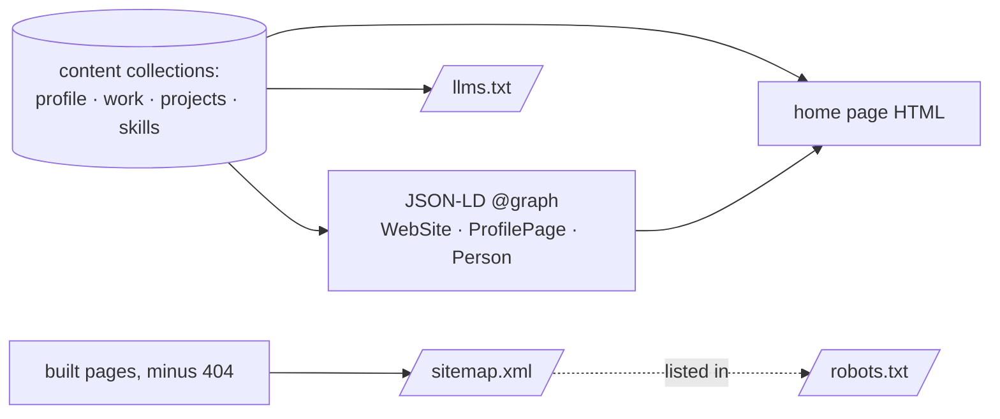
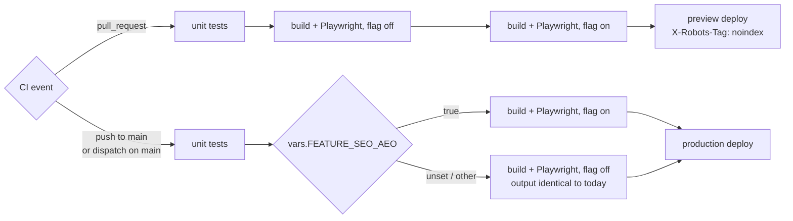

# PRD — SEO and AEO for masnunsiam.com

**Status:** Approved · **Date:** 2026-10-22 · **Slug:** `seo-aeo` · **Owner:** Masnun Siam · **Priority:** medium · **Repo:** masnun-siam/masnun-siam

## Overview

Make `masnunsiam.com` easy for search engines (SEO) and answer engines such as ChatGPT search, Perplexity, Claude, Gemini and Google AI Overviews (AEO) to find, understand and quote correctly. The site is the static Astro portfolio in `site/`, shipped by [portfolio-site](docs/prds/portfolio-site.md) (released v0.1.0). Visitors see no change; crawlers get a sitemap, machine-readable facts about Masnun, a plain-text summary for language models, and the site gets registered with Google and Bing.

Today:
- One page (`/`) plus a `noindex` 404 page, fully rendered at build time, so all content is in the HTML without JavaScript.
- The page already has a title, a meta description, a canonical URL (`https://masnunsiam.com/`), Open Graph and Twitter card tags, an OG image and a favicon (portfolio-site FR-9). A Playwright test checks those tags.
- `robots.txt` is `User-agent: *` / `Allow: /`, with no `Sitemap:` line.
- There is no sitemap, no structured data (JSON-LD), and no `llms.txt`.
- Content (profile, work, projects, skills) lives in typed content collections that are validated at build time.
- A strict CSP (portfolio-site FR-11) allows only `'self'` and one hashed inline script. A build check fails when any inline `` input, the no-current-role case, de-duplication, the empty-skills case (no `knowsAbout`), and the no-comma location case. Google's Rich Results Test and the Schema.org validator report no errors for the production URL (release checklist).
- **FR-4 llms.txt.** With the flag on, the build publishes `/llms.txt` in the llmstxt.org format, built from the content collections:
  - `# Masnun Siam`, then a one-line `>` summary "tagline — location", then the About paragraphs.
  - `## Work`: one line per role, in the same order as the Work section, as `- Title, Company (Mon YYYY – Mon YYYY), Location · Mode`, with `Present` as the end of a current role.
  - `## Projects`: one line per project in display order, `- [name](repo URL): description`.
  - `## Skills`: one line per skill group, `- Title: item, item, ...`.
  - `## Contact`: `- Email: <address>` then one line per social link, `- [Label](url)`.
  - A section whose list is empty is left out entirely (no placeholder text).
  - No content appears in `llms.txt` that is not on the page.
  - Acceptance: with the flag on, `GET /llms.txt` returns 200 with a `text/plain` content type, starts with `# Masnun Siam`, has the non-empty sections in the order above, and every role, project, skill group, the email and every social link from the content files appears in it. The builder's unit tests (FR-9) prove an empty list drops its section. Changing a project description in the content file changes `llms.txt` in the next build with no other edit. The release checklist confirms production serves it as `text/plain; charset=utf-8` (Pages does this for `.txt` today; see Baseline).
- **FR-5 CSP build check accepts JSON-LD data blocks.** The build check that compares inline scripts with the CSP skips a `<script>` element only when it has no `src` and its `type` attribute is exactly `type="application/ld+json"` (double-quoted, no extra characters). Every other inline script, including a differently written JSON-LD type, is checked exactly as today and fails without a hash. The CSP itself is unchanged, since browsers do not execute data blocks and CSP does not apply to them.
  - Acceptance: a flag-on build passes the check. The check's unit tests (FR-9) show these inline scripts fail without a hash: no type, `type="module"`, `type="text/javascript"`, `type="application/ld+json "` (trailing space), `type='application/ld+json'` (single quotes); and `type="application/ld+json"` passes. The Playwright smoke test sees no console errors (including CSP violations) on the home page with the flag on.
- **FR-6 Crawler access at the edge (owner, release checklist).** At release, the owner confirms in the Cloudflare dashboard for `masnunsiam.com` that "Block AI bots" is off and "Managed robots.txt" is off, and that no custom WAF rule challenges or blocks verified bots. Bot Fight Mode and the managed WAF stay as they are; Cloudflare lets verified bots through them. Nothing is changed through an API and no credential is written anywhere. The Baseline shows this already holds today; the step re-confirms it.
  - Acceptance (all three): (1) the dashboard shows both settings off; (2) a plain `curl https://masnunsiam.com/robots.txt` returns 200 and is byte-identical to the built file; (3) after FR-8, Search Console's live URL test fetches `/` successfully. A `curl` with a spoofed crawler user agent is informational only: a 200 is reassuring, a challenge is inconclusive.
- **FR-7 Feature flag `FEATURE_SEO_AEO` and the release trigger.** The site build reads `FEATURE_SEO_AEO` from the environment; only the exact value `true` turns it on.
  - With the flag off, the built site is the same as today: no `sitemap.xml`, no `llms.txt`, `robots.txt` byte-identical to today's, and no JSON-LD in any page.
  - CI (D5): a pull-request run builds and tests both states, flag off and flag on, and the flag-on build is what the preview deploys. A push to `main` builds and tests once, in the state given by the repository variable `vars.FEATURE_SEO_AEO` (unset, so off, until a release).
  - The flag reaches the build and test steps only as a fixed workflow expression (literal `true`/`false` per PR build, or the repository variable on `main`), never from PR-controlled text. The fork-PR guard on the preview deploy stays.
  - The deploy workflow gains a manual `workflow_dispatch` trigger. A dispatch on `main` runs the gate in the repository variable's state and, if it passes, deploys production, exactly like a push to `main`. The production deploy condition becomes "push or dispatch" **and** `ref` is `refs/heads/main`; the ref check is mandatory, so a dispatch on any other ref runs the gate and deploys nothing.
  - On a PR, only the flag-on build is uploaded as the build artifact the preview deploys; the flag-off build is tested and never uploaded. The preview keeps the sanitised branch name.
  - `FLAGS.md` gets a row: `FEATURE_SEO_AEO`, `docs/prds/seo-aeo.md`, the epic, default off, status off.
  - Acceptance: a build with the flag unset produces `/sitemap.xml` and `/llms.txt` as 404s, a `robots.txt` byte-identical to today's, and a home page with no `application/ld+json` block. `FEATURE_SEO_AEO=1` or `TRUE` behaves as off. A PR run shows both states tested and the preview has `/sitemap.xml`. Before release, production `GET /sitemap.xml` returns 404, because every merge to `main` deploys the off state; this is also what a rollback produces. With the variable set to `true`, dispatching the workflow on `main` makes it return 200. Dispatching on a branch other than `main` deploys nothing to production.
- **FR-8 Search-console verification (owner, after release).** In the same sitting as FR-6, the owner verifies `masnunsiam.com` as a Domain property in Google Search Console and as a site in Bing Webmaster Tools (Bing can import from Google), both by DNS TXT record added in the Cloudflare dashboard, with 2FA on the Google and Microsoft accounts. The TXT records stay in place afterwards (removing them drops verification). The owner submits `https://masnunsiam.com/sitemap.xml` in both. No verification file or meta tag goes into the repo and no agent gets a DNS-edit token.
  - Acceptance: both consoles show the property verified and the sitemap status "Success" with 1 discovered URL. Search Console's URL Inspection shows `https://masnunsiam.com/` as indexable with the user-declared canonical accepted.
- **FR-9 Tests.**
  - **Unit tests** with Node's built-in test runner (no new dependency), run as a new `test:unit` script in the CI gate before the build: the JSON-LD builder, the `llms.txt` builder and the CSP check's decision logic, each as a pure function fed fixtures. They cover every unit case named in FR-3, FR-4 and FR-5.
  - **Playwright** against the built site: each run reads `FEATURE_SEO_AEO` from its environment and runs the assertions for that state, skipping the other state's. Flag on: the FR-1 to FR-4 acceptance lines that run against the built site, plus a JSON-LD block under 3 KB. Flag off: the FR-7 flag-off acceptance. Because each state asserts its own outputs exist or are absent, a stale build from the other state fails the run. The existing SEO tag test passes in both states.
  - Acceptance: breaking any of these on purpose (removing the `Sitemap:` line, dropping `sameAs`, emptying `llms.txt`, emitting JSON-LD with the flag off, letting a raw `<` through the serializer) fails the PR's CI before merge.

## Edge cases

- **No current role:** `jobTitle` and `worksFor` are omitted; the build passes. `llms.txt` lists the roles normally (FR-3, unit-tested).
- **Empty content lists:** no roles, projects or skills → that `llms.txt` section is left out (FR-4), and `knowsAbout` is omitted rather than empty (unit-tested).
- **Duplicate skill items** across groups appear once in `knowsAbout` (unit-tested).
- **Special characters:** `<`, `>`, `&` in content are escaped in JSON-LD (FR-3) and in sitemap XML (FR-1). `llms.txt` is plain text, needs no escaping, and may contain non-ASCII characters (`·`, `–`), which is why its UTF-8 charset is checked at release.
- **Location with no comma:** no `address` in the Person; the build passes (unit-tested).
- **Stale facts:** the Person node republishes the current role. When the owner's job changes, editing `work.yaml` updates the page, the JSON-LD and `llms.txt` together; nothing else needs editing.
- **Preview deployments:** PR previews build with the flag on, so their sitemap and JSON-LD point at `https://masnunsiam.com`. Pages sends `X-Robots-Tag: noindex` on previews (Baseline), so they are not indexed.
- **The `masnunsiam.pages.dev` production alias** serves the same content without `noindex`. The canonical tag points at the apex, which is enough for search engines to consolidate it (D7).
- **Owner skips the checklist:** if FR-6 or FR-8 is not done, the code release still stands, but the release note must not claim the site is verified or indexed; the release stays open on those items.
- **Concurrency:** none. The output is static and built once per state per run.
- **Existing data:** nothing to migrate. Content files are unchanged.
- **Data isolation:** not applicable. Public single-owner site, no visitor data.
- **Private info:** structured data and `llms.txt` publish only what the page already shows. No phone number, street address, birth date or photo; the JSON-LD carries no email.

## Technical design

### Data

Not affected. No content-collection schema changes. FR-1 to FR-4 read the existing `profile`, `work`, `projects` and `skills` collections.

*Every crawler-facing output is built from the same content as the visible page (flag on).*

### API

Not affected. Static files in the build output when the flag is on:

| Path | Content type | Source |
|---|---|---|
| `/sitemap.xml` | XML | built pages except 404 (FR-1) |
| `/robots.txt` | text/plain | changed: adds the `Sitemap:` line (FR-2) |
| `/llms.txt` | text/plain; charset=utf-8 (Pages default for `.txt`) | content collections (FR-4) |

### Backend

Not affected. No Pages Functions or Workers, and no `_headers` change. `robots.txt`, `sitemap.xml` and `llms.txt` are produced by the static build so they can depend on the flag; `robots.txt` therefore stops being a hand-written static asset.

### Frontend

- **Home page head (FR-3):** one JSON-LD data block in `<head>`, flag on only. No visible markup changes. The 404 page is unchanged.
- **Builders (FR-3, FR-4):** the JSON-LD graph and the `llms.txt` text are each produced by a pure function of the content data, so they can be unit-tested with fixtures (FR-9).
- **Build-time flag (FR-7):** read once at build time from the process environment, strictly equal to `"true"`. No client-side code reads it.
- **CSP check (FR-5):** the existing post-build check skips only the exact JSON-LD data-block form; its per-script decision is a pure function for unit tests.

### Realtime and other services

- **Realtime:** not affected.
- **GitHub Actions (FR-7, FR-9):** the gate runs the unit tests, then builds and runs Playwright: twice on a PR (off, then on; the on build is the preview artifact), once on a push to `main` or a dispatch on `main` (the repository variable's state). Production deploy runs on a push to `main` or a dispatch on `main`, after the gate passes, under the existing `FEATURE_PORTFOLIO_SITE` condition.
- **Cloudflare zone (FR-6):** dashboard check by the owner only. The agents' Pages deploy token is unchanged and cannot change zone settings.
- **Google Search Console and Bing Webmaster Tools (FR-8):** the owner's accounts; DNS TXT records on the Cloudflare zone. Nothing in the repo.

*How the flag reaches each build, and how a release redeploys without a code change (FR-7).*

### Non-functional

- **Performance:** the JSON-LD block stays under 3 KB (Playwright, FR-9). Lighthouse mobile ≥ 95 for Performance, Best Practices and SEO (portfolio-site FR-10) is re-checked by hand on production at release.
- **Security:** CSP and headers unchanged. JSON-LD output is escaped (FR-3). The CSP check exemption is exact and fails closed (FR-5). No third-party script, request or verification file. No new dependency. The flag never comes from PR-controlled text (FR-7).
- **Compatibility:** sitemaps.org 0.9; schema.org vocabulary as accepted by Google's Rich Results Test; llmstxt.org format.
- **Code hygiene:** no `console.log`, no `any`, strict TypeScript, per the repo's existing rules.

### Testing

| Requirement | How it is proven |
|---|---|
| FR-3 escaping, no current role, de-dupe, location; FR-4 empty sections; FR-5 exemption cases | Node unit tests with fixtures, CI gate (FR-9) |
| FR-1, FR-2, FR-3 (shape, values, size), FR-4 | Playwright against the built site, flag on (PR CI) |
| FR-7 off state | Playwright, flag off (PR CI and `main` CI) |
| FR-7 dispatch, release and rollback | Production `curl /sitemap.xml`: 404 before release (merges deploy the off state, the same output a rollback gives), 200 after the release dispatch — release checklist; dispatch on a non-`main` branch deploys nothing — checked once when the trigger is added |
| FR-3 rich-results validity; FR-4 charset; Lighthouse | Rich Results Test, Schema.org validator, `curl -I /llms.txt /sitemap.xml`, Lighthouse on production — release checklist |
| FR-6, FR-8 | Owner checklist at release |

## Rollout and cost

- **Release:** merges ship dark (`FEATURE_SEO_AEO` unset). After Siam confirms the release, the Release agent sets the repository variable `FEATURE_SEO_AEO=true`, dispatches the deploy workflow on `main`, and records `released <tag>` in `FLAGS.md`.
- **Release checklist:**
  1. Release agent: production `GET /sitemap.xml` returns 404 before the dispatch and 200 after it; `curl -I` shows XML for `/sitemap.xml` and `text/plain; charset=utf-8` for `/llms.txt`.
  2. Release agent: Rich Results Test and Schema.org validator on `https://masnunsiam.com/` report no errors; Lighthouse mobile ≥ 95 for Performance, Best Practices and SEO.
  3. Owner, in one sitting: FR-6 dashboard check, then FR-8 verification and sitemap submission.
- **Agents never wait on the owner checklist before release.** It is presented to Siam together with the release confirmation, which is the one point where Siam is involved.
- **Rollback:** unset the variable and dispatch the workflow on `main`; production returns to today's output.
- **Cost:** none. Everything is on free tiers.

## Success metrics

- **Owner checks at release + 4 weeks** (the Release agent records the result on the release task the next time Siam is involved; not a gate): Search Console shows `https://masnunsiam.com/` indexed, and a Google search for "Masnun Siam" returns the site on the first page (Baseline: not returned today).
- **Release agent at release:** Rich Results Test detects the ProfilePage with no errors.
- **Informal, not a gate:** asking ChatGPT search and Perplexity "Who is Masnun Siam, the software engineer in Dhaka?" returns an answer that cites `masnunsiam.com`.

## Epics

- **E1 SEO and AEO for masnunsiam.com** — covers FR-1 to FR-9. Issue: #41

## Decisions

- **D1 Structured data scope** — status: settled (round 1, all lenses agree). WebSite + ProfilePage + Person only. `ProfilePage` with a `Person` `mainEntity` is the type Google documents for profile pages, and the Person carries the facts answer engines need. Projects and roles are already in `llms.txt` and the visible HTML.
- **D2 Sitemap generation** — status: settled (round 1). A small build-time output of our own, no `lastmod`; no `@astrojs/sitemap`. One indexable page, and the repo avoids dependencies a few lines can replace. No `lastmod` means never sending a misleading date.
- **D3 llms.txt** — status: settled (round 1). Publish `/llms.txt` built from content; no `llms-full.txt`. Cheap, cannot drift, some LLM tools fetch it; its effect on major answer engines is unproven, so the goals do not depend on it.
- **D4 AI crawler policy** — status: settled (round 1). Allow every crawler, including training crawlers, with plain `User-agent: *` / `Allow: /`; no per-bot rules and no `Content-Signal`. The goal is to be known and cited; a portfolio has nothing to protect from training.
- **D5 How the flag reaches the build** — status: settled (round 2, all lenses agree).
  - Round 1: QA disagreed with "PR builds on, `main` follows the variable", because the off state was first tested after merge, when production deploys. All other lenses agreed.
  - Options: (a) **PR runs build and test both states and preview the flag-on build; `main` pushes and dispatches build once in the variable's state (recommended)**; (b) the round-1 proposal: PR builds on only; (c) every run builds both states, including `main`.
  - Why (a): it proves both states before merge, which is QA's point, at the cost of one extra build and Playwright run on PRs (well under a minute for one page). (b) lets a broken off state reach production. (c) adds that cost to `main` runs, where only the deployed state matters.
- **D6 Search-engine registration** — status: settled (round 1). Owner verifies Google Search Console (Domain property) and Bing Webmaster Tools by DNS TXT after release, manually; no IndexNow. Needs the owner's accounts; Bing matters for AEO because ChatGPT search and others use its index.
- **D7 Duplicate `masnunsiam.pages.dev` host** — status: settled (round 1). Rely on the canonical tag; no host-matched `X-Robots-Tag` rule.
- **D8 Person image** — status: settled (round 1). No `image`. No photo exists, and the OG name card is not a photo of a person.
- **D9 FAQ or Q&A content** — status: settled (round 1). No FAQ section and no `FAQPage` schema. Google shows FAQ rich results only for well-known government and health sites since 2023.
- **D10 JSON-LD and the CSP** — status: settled (round 1). CSP unchanged; the build's hash check exempts the exact JSON-LD data-block form (FR-5). Browsers do not execute data blocks.
- **D11 Visible changes** — status: settled (round 1). None; metadata and crawler files only.
- **D12 Priority** — status: settled (round 1). Medium: personal project, no deadline, nothing broken.
- **D13 Person `description`** — status: settled (round 2, all lenses agree; raised by UX in round 1).
  - Options: (a) **the profile tagline, "Software Engineer · Laravel · Flutter · AI tools" (recommended)**; (b) the first About paragraph (the round-1 text); (c) a new third-person `summary` field in the profile content.
  - Why (a): it is short, factual and already on the page. The About paragraphs are first-person ("I'm a software engineer..."), which reads oddly when an answer engine quotes it as a description of Masnun. (c) adds a content field and copy the owner would have to write, for little gain over (a).
- **D14 Email in machine-readable outputs** — status: settled (round 2, all lenses agree; raised by Security in round 1).
  - Options: (a) **no `email` in the JSON-LD; keep the email in `llms.txt` Contact (recommended)**; (b) email in both; (c) email in neither.
  - Why (a): a JSON-LD `email` gains nothing for search, and drops one more harvestable copy. `llms.txt` is where an assistant answering "how do I contact Masnun" looks, and the address is already on the page as a `mailto:` link, so (c) protects nothing.

## Open questions

None.

## Change log

- —

## Related

- [portfolio-site PRD](docs/prds/portfolio-site.md) (FR-9 SEO and sharing, FR-10 performance, FR-11 security headers, FR-12 deploy pipeline, FR-13 quality gate).
- `FLAGS.md` in the repo.
- Paperclip task PER-80; panel round 1: PER-81 to PER-86; round 2: PER-87 to PER-92 (all approve).
